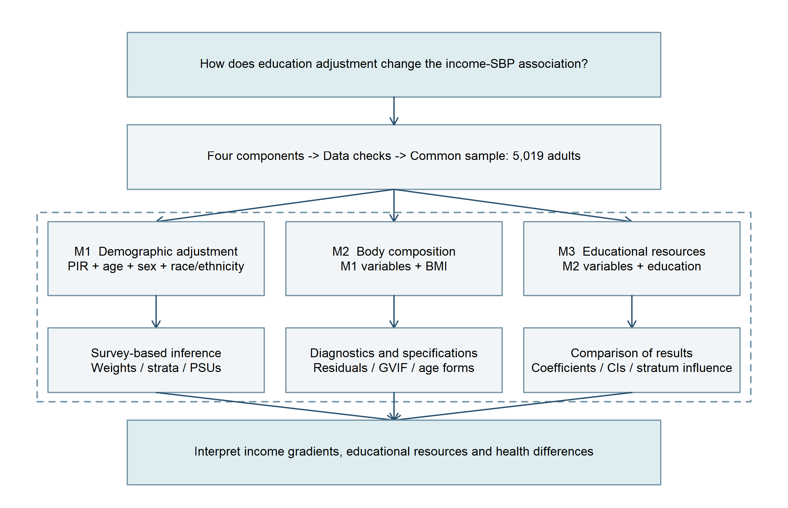

# NHANES Social Data Science and Public Health


## Income, education and systolic blood pressure

An R-based study of social determinants of health using NHANES August 2021–August 2023. Four components containing 11,933 participants are linked to obtain a common complete-record sample of 5,019 adults. Sequential survey-weighted regressions compare demographic adjustment, additional BMI adjustment, and additional education adjustment.

| Model | PIR coefficient (mmHg) | 95% CI |
|---|---:|---|
| M1 Demographics | -0.682 | -1.193 to -0.171 |
| M2 + BMI | -0.656 | -1.193 to -0.119 |
| M3 + Education | -0.201 | -1.014 to 0.612 |

The income gradient attenuates after education adjustment. All models use the same participants and incorporate examination weights, strata and PSUs.



## Files and data

- [`data/raw/`](data/raw/): four original public-use NHANES XPT files, unchanged from the study inputs.
- [`data/processed/nhanes_complete_5019.csv`](data/processed/nhanes_complete_5019.csv): the complete analytical dataset, 5,019 records and 11 columns, with no missing cells. An equivalent XPT is included.
- [`data/README.md`](data/README.md): provenance, variable definitions, coding and data-use information.
- [`R/run_analysis.R`](R/run_analysis.R): linkage, cleaning, sample selection, estimation and diagnostics.
- [`R/render_figures.R`](R/render_figures.R): seven English figures.
- [`results/`](results/): numerical results, sample flow and verification outputs.
- [`figures/`](figures/): framework, sample filtering, group means, coefficients, adjusted curves, residuals and age specifications.
- [`manuscript/`](manuscript/): English research draft with editable Word equations.

## Reproduce

Clone or download this repository. In R, install `haven` and `survey` if needed, set the working directory to the repository root, and run:

```r
source("R/run_analysis.R", encoding = "UTF-8")
```

The four input XPT files are already included; no archived local workspace is required. The pipeline generates results and figures, with final CSV/XPT outputs under `data/final/`. The pre-generated analytical dataset is provided under `data/processed/`. Regenerated intermediate RDS files are ignored by Git. The standalone pipeline was tested against the saved main-model estimates.

## License and attribution

Original R code and project documentation are licensed under the [MIT License](LICENSE). Please retain the copyright and permission notice when reusing the software. The research manuscript and scientific figures retain the author's copyright unless separately licensed.

NHANES public-use data originate from CDC/NCHS; they are not relicensed as MIT software. See the [official NHANES citation guidance](https://wwwn.cdc.gov/nchs/NHANES/NhanesCitation.aspx) and the [data provenance notes](data/README.md). The processed values derive from those public-use files; cite CDC/NCHS and describe any additional processing when reusing them.

## Research status

Author: Qiyong Yang. Research draft, not yet peer reviewed or posted as a preprint. AI assistance was used in code preparation, figure production, translation checking and manuscript editing; the author remains responsible for the original writing and review of the work.
